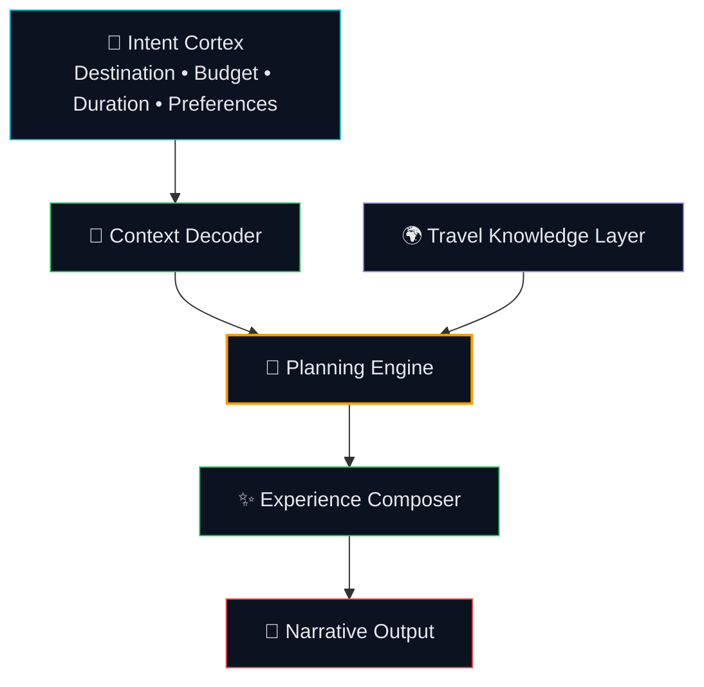
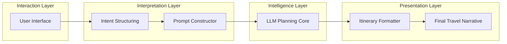

<!-- ===================================================== -->
<!-- AI Trip Planner — README.md -->
<!-- Premium • Interactive • Brand-Consistent -->
<!-- ===================================================== -->

<div align="center">


<br/>


<br/><br/>

<a href="#-quickstart"><b>Quickstart</b></a> •
<a href="#-experience-orchestration"><b>Experience Flow</b></a> •
<a href="#-neural-travel-brain"><b>Neural Brain</b></a> •
<a href="#-cognitive-flow-model"><b>Cognitive Model</b></a> •
<a href="#-planning-system-architecture"><b>Architecture</b></a> •
<a href="#-system-impact"><b>Impact</b></a> •
<a href="#-contact"><b>Contact</b></a>

</div>

---


<!-- quickstart:start -->
# 🚀 Quickstart

[](https://github.com/Navyagowda2714/AI-Trip-Planner/actions/workflows/tests.yml)

**Requirements:** Python 3.10+ and API keys for an LLM plus the tools:

| Key | Used for | Free tier |
|---|---|---|
| `GROQ_API_KEY` (or `OPENAI_API_KEY`) | LLM that drives the agent | [console.groq.com](https://console.groq.com) |
| `TAVILY_API_KEY` | Web search fallback for places | [tavily.com](https://tavily.com) |
| `GPLACES_API_KEY` | Google Places search | Google Cloud |
| `OPENWEATHERMAP_API_KEY` | Current weather + forecast | [openweathermap.org](https://openweathermap.org/api) |
| `EXCHANGE_RATE_API_KEY` | Currency conversion | [exchangerate-api.com](https://www.exchangerate-api.com) |

```bash
git clone https://github.com/Navyagowda2714/AI-Trip-Planner.git
cd AI-Trip-Planner
python -m venv .venv && source .venv/bin/activate   # Windows: .venv\Scripts\activate
pip install -r requirements.txt
cp .env.example .env        # then fill in your keys
```

**Option A — one process (simplest):** the Streamlit app runs the LangGraph agent directly.

```bash
streamlit run streamlit_app.py          # → http://localhost:8501
```

**Option B — API + UI:** run the FastAPI backend and point the UI at it.

```bash
uvicorn main:app --reload --port 8000   # POST /query {"question": "..."}
BACKEND_URL=http://localhost:8000 streamlit run streamlit_app.py
```

**Run the tests** — no API keys needed, all external calls are mocked:

```bash
pip install -r requirements-dev.txt
pytest -v
```

**Deploy your own live demo (Streamlit Community Cloud, free):** fork the repo → [share.streamlit.io](https://share.streamlit.io) → *New app* → main file `streamlit_app.py` → paste your keys under *Advanced settings → Secrets* using the format in `.streamlit/secrets.toml.example`.

| Path | What it is |
|---|---|
| `agent/agentic_workflow.py` | LangGraph `StateGraph`: agent node ↔ tool node loop |
| `tools/` | LangChain tools exposed to the agent (weather, places, currency, expenses) |
| `utils/` | API clients and helpers the tools call |
| `prompt_library/prompt.py` | System prompt for the travel agent |
| `main.py` | FastAPI backend (`POST /query`) |
| `streamlit_app.py` | Streamlit UI (standalone or backend-client mode) |
| `tests/` | pytest suite, runs in CI on every push |
<!-- quickstart:end -->

---

# 🌍 Experience Orchestration

<details open>
<summary><b>🧭 From User Intent → Designed Travel Experience (click to collapse)</b></summary>

<br/>


</details>

This system transforms structured constraints into experience logic —  
not just text output.

---

# 🧠 Neural Travel Brain

<details open>
<summary><b>🧬 Cognitive Architecture Map (click to collapse)</b></summary>

<br/>



</details>

This layered cognition separates:

- Understanding  
- Reasoning  
- Structuring  
- Presentation  

Which makes the system scalable and controllable.

---

# 🧠 Cognitive Flow Model

<details open>
<summary><b>🧩 Planning Cognition Ladder (click to collapse)</b></summary>

<br/>

<div align="center">

<table>
<tr>
<td width="20%" align="center">

**Intent Parsing**  
📍 Destination  
💰 Budget  
📅 Duration  
🎯 Preferences  

</td>
<td width="5%" align="center">➡️</td>
<td width="20%" align="center">

**Constraint Modeling**  
Time distribution  
Budget limits  
Travel pacing  

</td>
<td width="5%" align="center">➡️</td>
<td width="20%" align="center">

**Reasoned Planning**  
Activity clustering  
Logical sequencing  
Balanced day design  

</td>
<td width="5%" align="center">➡️</td>
<td width="20%" align="center">

**Experience Composition**  
Readable format  
Narrative clarity  
Human tone  

</td>
</tr>
</table>

</div>

<br/>

The architecture deliberately separates:

- 🧠 reasoning  
- ⏱ sequencing  
- 🖋 formatting  

This prevents chaotic generation  
and enables structured AI planning.

</details>

---

# 🏗 Planning System Architecture

<details open>
<summary><b>⚙️ Layered Structural Boundaries (click to collapse)</b></summary>

<br/>



<br/>

```
Interaction Layer    → Collect user intent
Interpretation Layer → Convert intent into structured reasoning
Intelligence Layer   → Perform AI planning logic
Presentation Layer   → Control narrative clarity
```

Clear boundaries.  
No blurred logic layers.

</details>

---

# 🌟 System Impact

This project demonstrates:

- Structured prompt engineering  
- AI-powered decision systems  
- Controlled itinerary generation  
- Modular reasoning architecture  
- Experience-centered AI output design  

It treats LLMs as cognitive engines inside a defined architecture —  
not free-form generators.

---

# 📬 Contact

<div align="center">

<a href="https://www.linkedin.com/in/navyashree-byregowda-472821196/">

</a>

<a href="https://github.com/Navyagowda2714">

</a>

<a href="mailto:navyashreebyregowda@gmail.com">

</a>

<br/><br/>
<sub>AI Trip Planner — structured intelligence for human travel experiences.</sub>

</div>
